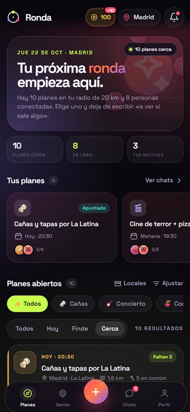
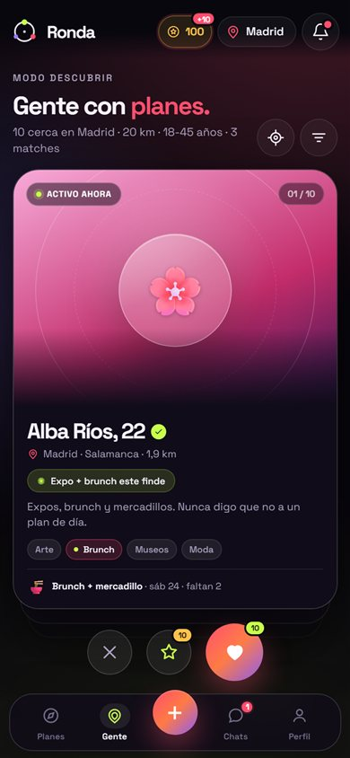
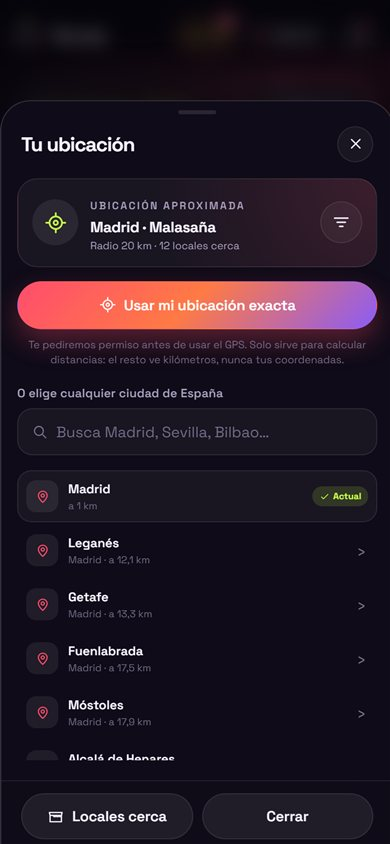

# Ronda

**Que nunca falte gente.**

App Android instalable (PWA) + backend compartido para completar planes con gente nueva: crea un plan abierto, haz match con perfiles afines y organizadlo en un chat privado.

> Hackathon 26-27 · PWA mobile-first · Backend Python sin dependencias · SQLite · Tiempo real por SSE

<p align="center">
  
  
  
</p>

**Repositorio:** <https://github.com/iker-alva/Ronda-app>

---

## Arrancar

### Opción rápida en Windows

1. Descarga **`Ronda-Windows.zip`** desde [Releases](https://github.com/iker-alva/Ronda-app/releases/latest).
2. Descomprime y haz doble clic en **`Ronda.exe`**.
3. Se abre una ventana con dos direcciones: la local y la de tu red wifi.
4. Comparte la dirección de red con quien quieras: todas las personas usan la misma base de datos.

### Desde el código

```powershell
cd ronda
python server.py
```

- Local: <http://localhost:8788>
- Móvil en la misma wifi: `http://IP-DE-TU-PC:8788` (la consola imprime la IP)
- En Windows también puedes hacer doble clic en `iniciar.bat`.

### Cuentas de demo

| Persona | Usuario | Contraseña | Qué probar |
|---|---|---|---|
| Lucía Ferrer | `lucia` | `demo1234` | Tiene planes, 3 matches, 100 monedas y una solicitud pendiente |
| Hugo Salas | `hugo` | `demo1234` | Organiza un concierto con chat de grupo |
| Vera Ortiz | `vera` | `demo1234` | Cine, salsa y matches |
| Nico Prieto | `nico` | `demo1234` | Ruta en bici y café |

Los perfiles del mazo ya incluyen **likes recíprocos** para que puedas ver un match y el chat en segundos.

### Instalar en Android

1. Abre la app en **Chrome para Android**.
2. Menú ⋮ → **Instalar aplicación** (o **Añadir a pantalla de inicio**).
3. Se abre a pantalla completa, con icono propio y shell offline.

> Chrome exige **HTTPS** para instalar desde una IP de red local. En `localhost` funciona sin más. Para probar en un móvil real con instalación, publica el servidor detrás de un túnel HTTPS (Cloudflare Tunnel, ngrok…) o súbelo a un VPS con certificado.

### Compartir con varias personas

- Ejecuta `Ronda.exe` en un ordenador que se quede encendido.
- Todos los dispositivos deben estar en la **misma wifi**.
- Comparte la dirección `http://TU-IP-DE-LA-RED:8788` que aparece en la ventana.
- La primera vez, Windows puede pedir permiso de firewall: permite **redes privadas**.
- Los datos se guardan en la carpeta **`Ronda data`**, junto al ejecutable. Copia esa carpeta para hacer una copia de seguridad.
- Si el puerto `8788` está ocupado, Ronda usa el siguiente libre y lo muestra.
- La app funciona sin internet. Para usarla fuera de casa, publica el puerto detrás de un túnel HTTPS o un servidor; no lo expongas directamente sin HTTPS.

---

## La idea

Quedar siempre falla por lo mismo: al final no sale nadie. Ronda ataca ese momento desde dos lados:

- **Planes abiertos (estilo Wizz):** alguien propone un plan y dice cuántas personas faltan. Cualquiera se apunta (o solicita plaza) y entra al chat de grupo.
- **Descubrir (estilo Tinder):** un mazo de gente con planes y aficiones en común. Deslizas, haces match y se abre un chat privado para concretar.
- **Cerca de verdad:** cambia entre más de 100 ciudades de España o usa el GPS. La app calcula distancias reales y te enseña planes y locales a tu alrededor.

No es una app para hacer amigos por hacer amigos: es una app para **salir**. El plan es el contexto, la gente es la compañía.

## Qué hace

### Ubicación y locales
- **Más de 100 ciudades de España** (capitales de provincia, áreas metropolitanas y ciudades costeras) con coordenadas.
- **Cambiar de ciudad** desde el chip de la barra superior, el perfil o los filtros; o pulsar **Usar mi ubicación exacta**.
- **GPS del navegador con consentimiento**: primero Ronda pregunta si autorizas la ubicación exacta y solo después el navegador pide permiso. Calcula ciudad y barrio cercanos. Puedes desactivarla cuando quieras desde el mismo panel.
- **Distancias reales** (haversine) entre tú y cada persona, plan o local; nunca se muestran tus coordenadas exactas a los demás.
- **Radio de descubrimiento** configurable (1–40 km) y filtro «Cerca» que usa tu radio.
- **Locales cerca**: 85 sitios de referencia (salas, plazas, mercados, parques, bares…) con distancia y botón para crear un plan allí.
- **Sugerencias de sitio** en el formulario de plan según la ciudad elegida; también puedes escribir un sitio libre.

### Planes
- **Crear planes** con título, categoría, día, hora, **ciudad**, barrio, sitio, plazas y vibes.
- **Plazas reales**: «faltan 2», completa automáticamente y vuelve a abrirse si alguien sale.
- **Apuntarse al instante** o **solicitar plaza** si el anfitrión revisa solicitudes.
- **Chat de grupo automático** con todos los apuntados y tarjeta del plan fijada.
- **Aceptar o rechazar solicitudes**, salir del plan y cancelarlo (también desde el chat del plan).
- **Filtros** por categoría (cañas, concierto, cine, deporte, cultura…), Hoy, Finde y Cerca.
- **Tus planes** de cualquier ciudad, con el chat a un toque.

### Descubrir y matches
- **Mazo de perfiles** con distancia real, edad, intereses, estado del día y su plan abierto.
- **Swipe** con gestos (derecha/izquierda/arriba) o botones: me apunto, paso, superlike.
- **Match mutuo** con celebración, confeti y apertura de chat privado.
- **Orden por intereses en común** y filtros de distancia y edad.
- **Reiniciar mazo** para volver a ver perfiles descartados (los matches se conservan).

### Chats
- **Chat privado por match** y **chat de grupo por plan**.
- **Mensajes en tiempo real** (SSE) y notificaciones en la app.
- **Sugerencias rápidas** para romper el hielo.
- **Tiempo relativo**, separadores por día y no leídos por conversación.
- **Tarjeta del plan** siempre visible en el chat de grupo.

### Perfil y diseño
- Perfil con avatar emoji + degradado, edad, **ciudad y barrio**, bio, estado del día, intereses y «qué buscas».
- **Persistencia de cada cuenta**: perfil, preferencias, planes, matches, mensajes y monedas se guardan en SQLite. Cerrar el navegador o el `.exe` no borra nada.
- **Mis datos**: descarga un JSON con tu perfil, planes, chats, monedas y avisos desde **Perfil → Mis datos**.
- Estadísticas de planes, matches y conexiones.
- **4 temas** conmutables en caliente: Noche, Neón, Sunset y Claro.
- 14 avatares y 40 intereses; sin fotos externas y sin dependencias visuales.
- Instalable como PWA y con shell offline.

### Monedas
- **+100 monedas de bienvenida** la primera vez que entras (registro o primer login).
- **+10 monedas cada día** desde la cartera, una vez por día natural.
- **Cada like o superlike cuesta 10 monedas**; pasar de perfil es gratis.
- **Nunca puedes bajar de 0**: si no llegas a 10, el like no se envía y la app te lleva a la cartera.
- **Cartera con historial**: saldo, recompensa diaria y todos los movimientos (bienvenida, diaria, likes).
- El saldo se actualiza en la barra superior y en el perfil; recompensa diaria marcada con un badge `+10`.

---

## Demo en 5 minutos (guion para jurado)

1. **Entra como Lucía** desde los accesos rápidos de la pantalla de inicio.
2. **Planes**: hero con planes cerca, tus 4 planes y la solicitud pendiente de Sara en «Terraceo after curro».
3. Pulsa **«Me apunto»** en un plan abierto: entra al instante y se abre el **chat de grupo** con la tarjeta del plan.
4. Ve a **Gente**: Alba, 22, con su plan de brunch. Desliza a la derecha (o pulsa el corazón) → **¡Match!** con confeti. Cada like descuenta 10 monedas.
5. Pulsa el **chip de monedas** de la barra superior: verás 100 de bienvenida y la recompensa diaria de +10. Reclámala y comprueba el historial.
6. **Cambia de ciudad**: toca «Madrid» en la barra superior, elige Barcelona y observa cómo cambian planes, gente y locales.
7. Pulsa **«Usar mi ubicación exacta»**: verás primero el aviso de consentimiento de Ronda y después el permiso del navegador. Si estás en localhost funciona; en una IP local por HTTP el navegador lo bloquea, así que elige una ciudad. Desde el mismo panel puedes **desactivar la ubicación exacta**.
8. Abre **Locales cerca** y toca Razzmatazz o la Boqueria: el formulario de plan se rellena con ciudad, barrio y sitio.
9. **Crea un plan** con el botón central: categoría, fecha, ciudad, sitio, plazas y vibes. Aparece en el listado y en «Tus planes».
10. Abre el plan de Sara en **Terraceo after curro** y **acepta su solicitud**: se crea el chat del plan con ella dentro.
11. **Perfil → Tema**: cambia a Neón, Sunset o Claro delante del jurado.
12. **Chats**: abre la conversación con Hugo, envía una sugerencia rápida y mira el estado de no leídos.
13. Vuelve a **Planes** y comprueba que todo sigue en su sitio. Sin recargas.

**Truco multiusuario:** abre dos ventanas (una normal y otra de incógnito), entra como Lucía y como Hugo. Haz match, apúntate a un plan o escribe: la otra ventana se actualiza sola por SSE.

---

## Arquitectura

```
server.py          HTTP + API REST + SSE + estáticos (stdlib)
core.py            dominio: auth, ciudades, locales, distancias, matching, seed
db.py              esquema SQLite y conexión (WAL)
gen_icons.py       generador de iconos PNG/ICO sin dependencias
build_exe.bat      compila Ronda.exe con PyInstaller
version_info.txt   metadatos del ejecutable de Windows
LEEME.txt          instrucciones para compartir el .exe
static/
  index.html       app shell
  styles.css       sistema de diseño + 4 temas
  app.js           SPA (ES modules, sin build step)
  sw.js            service worker (offline)
  manifest.webmanifest
  fonts/           Space Grotesk + licencia OFL
  icons/
docs/              capturas para el README
data/ronda.db      base de datos (se crea sola, ignorada por git)
```

- **Cero dependencias**: Python 3.9+ y SQLite de la biblioteca estándar.
- **Sin build step**: HTML/CSS/JS nativo, un solo `app.js`.
- **Modelo**: `users` (ciudad, lat/lon) → `plans` (ciudad, lat/lon, local) + `plan_members` (host/member, joined/pending/declined) → `threads` + `messages`; `venues` (locales con coordenadas); `swipes` → `matches` → chat privado.
- **Monedas**: `users.coins` + `coin_ledger` (cada movimiento con saldo resultante). Las compras son `UPDATE ... WHERE coins >= coste` para que el saldo nunca sea negativo. Bienvenida y diaria son idempotentes a nivel SQL.
- **Geografía**: distancias haversine entre las coordenadas del usuario, del plan y del local. Cambiar de ciudad guarda el centro de la ciudad; el GPS guarda la posición exacta solo tras el consentimiento. Los demás solo reciben kilómetros; las coordenadas de otros usuarios nunca salen del servidor.
- **Matching**: el mazo excluye perfiles ya swipeados, aplica distancia y rango de edad y ordena por intereses compartidos. Un `like` recíproco crea `matches` y un hilo privado.
- **Planes**: la capacidad es `plazas + anfitrión`; join instantáneo o pendiente según `approval`. El chat de grupo se crea/sincroniza al llegar a 2 personas y se conserva si el plan se queda solo.
- **Tiempo real**: `GET /api/events` (SSE) emite un evento por usuario en cada mutación; el cliente refresca estado y chat.
- **Demo**: el seed crea 35 perfiles repartidos por España, 30 planes, 85 locales, 107 ciudades, matches, chats, solicitudes y notificaciones con fechas relativas a hoy.

### API (resumen)

| Método | Ruta | Uso |
|---|---|---|
| POST | `/api/auth/register` | crear cuenta |
| POST | `/api/auth/login` | iniciar sesión |
| GET | `/api/demo-accounts` | accesos rápidos de demo |
| GET | `/api/catalog` | ciudades, locales, categorías, intereses y avatares |
| GET | `/api/state` | estado completo: planes, mazo, chats, avisos, locales y stats |
| POST | `/api/plans` | crear plan (ciudad, barrio, local o sitio libre) |
| POST | `/api/plans/{id}/join` | apuntarse o solicitar plaza |
| POST | `/api/plans/{id}/leave` | salir del plan |
| POST | `/api/plans/{id}/cancel` | cancelar (anfitrión) |
| POST | `/api/plans/{id}/members/{uid}/resolve` | aceptar/rechazar solicitud |
| POST | `/api/swipes` | like, pass o superlike (like/superlike cuestan 10 monedas); devuelve match y saldo |
| POST | `/api/swipes/reset` | reiniciar mazo |
| GET | `/api/wallet` | saldo, recompensa diaria e historial |
| POST | `/api/economy/daily` | reclamar las 10 monedas del día |
| GET | `/api/threads/{id}` | mensajes del chat (marca leído) |
| POST | `/api/threads/{id}/messages` | enviar mensaje |
| POST | `/api/threads/{id}/read` | marcar leído |
| PATCH | `/api/profile` | editar perfil, ciudad, GPS y preferencias |
| GET | `/api/me/export` | descargar tus datos: perfil, planes, chats, monedas y avisos |
| POST | `/api/notifications/read` | marcar avisos leídos |
| GET | `/api/events` | stream SSE por usuario |

---

## Variables de entorno

| Variable | Por defecto | Descripción |
|---|---|---|
| `RONDA_PORT` | `8788` | puerto |
| `RONDA_HOST` | `0.0.0.0` | interfaz (`127.0.0.1` para solo local) |
| `RONDA_DB` | `data/ronda.db` | ruta de la base de datos |
| `RONDA_DATA` | junto al `.exe` | carpeta de datos del ejecutable |
| `RONDA_OPEN` | `1` | abre el navegador al arrancar el `.exe` (`0` para no abrirlo) |
| `RONDA_LOG` | `1` | logs HTTP en consola (en el `.exe`, `0` por defecto) |

Para empezar de cero: borra `data/` (o `Ronda data/` junto al `.exe`) y vuelve a arrancar (se recrea con datos de ejemplo).

---

## Crear el ejecutable

```bat
build_exe.bat
```

- Requiere **Python 3.9+**; el script instala PyInstaller si falta.
- Genera `dist\Ronda.exe` y `dist\Ronda-Windows.zip`.
- El `.exe` incluye el backend y todos los archivos estáticos; no necesita Python instalado en el equipo que lo ejecuta.
- La primera vez crea una carpeta **`Ronda data`** junto al ejecutable (base de datos editable y copiable). **Todos los usuarios y sus datos se guardan ahí** y sobreviven al cierre del programa.
- Cada persona puede descargar su copia en **Perfil → Mis datos**.
- Windows puede mostrar SmartScreen por no estar firmado: **Más información → Ejecutar de todas formas**.
- El firewall debe permitir el acceso en **redes privadas** para que entren otros dispositivos.

---

## Límites conocidos

- El catálogo incluye **107 ciudades** de España (capitales, áreas metropolitanas y destinos costeros), no los 8.000+ municipios. Para una ciudad que no esté, el GPS busca la más cercana del catálogo.
- Los **85 locales** son una selección curada de ciudades principales. En ciudades sin locales guardados puedes escribir el sitio a mano; las coordenadas del plan usan el centro de la ciudad.
- La geolocalización requiere permiso del navegador y **HTTPS** (o `localhost`). Si se deniega, se puede elegir ciudad manualmente. La ubicación exacta se guarda solo tras un consentimiento explícito y se puede desactivar.
- No hay subida de fotos: los avatares son emoji + degradado, sin moderación de imágenes.
- No hay notificaciones push fuera de la app (solo in-app y SSE). Web Push sería el siguiente paso.
- La app asume una sola zona horaria (hora local del servidor).
- No hay recuperación de contraseña ni verificación de identidad.
- Las monedas son de demo: no hay compras reales, retiradas ni pasarela de pago.
- Los matches de demo vienen de likes recíprocos del seed; los usuarios nuevos empiezan sin likes entrantes.
- Para un producto real harían falta reportes/bloqueos, moderación y límites anti-spam.

## Licencias

- Código: uso libre para el hackathon.
- Space Grotesk: SIL Open Font License 1.1 — ver `static/fonts/OFL.txt`.
- La ubicación exacta es privada: se usa para calcular distancias y no se expone en la API pública.
